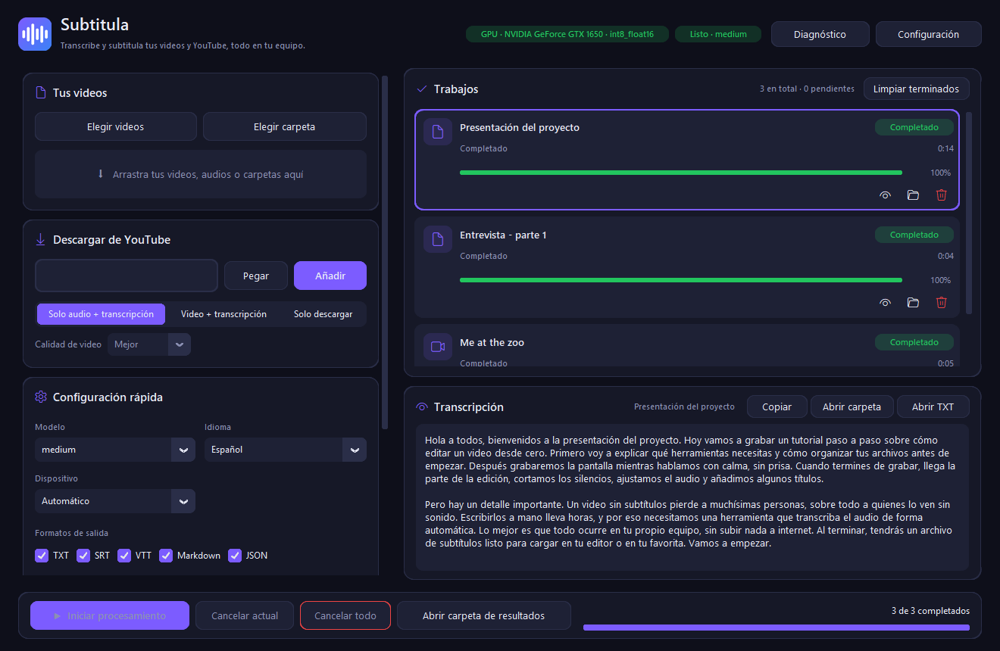
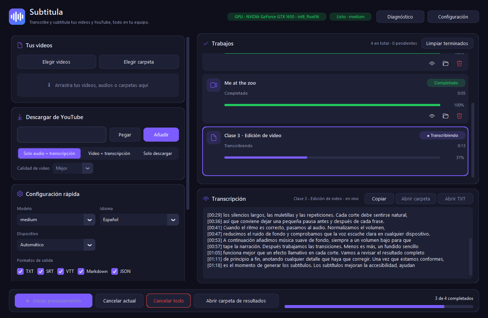
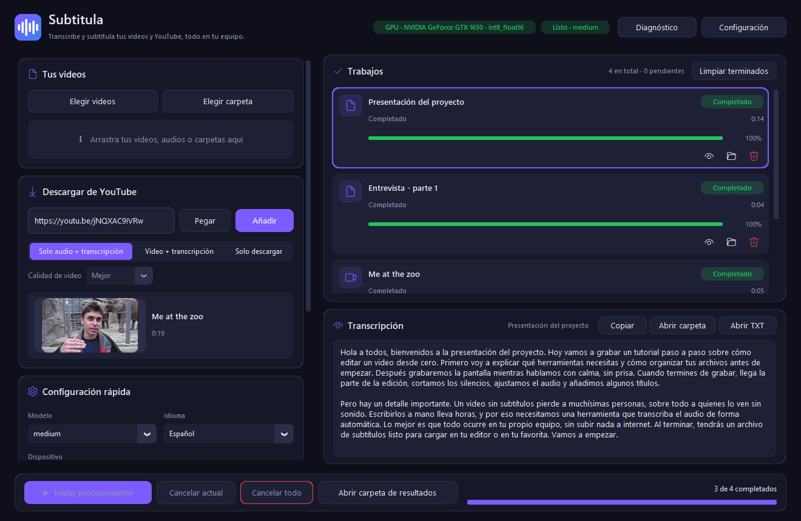
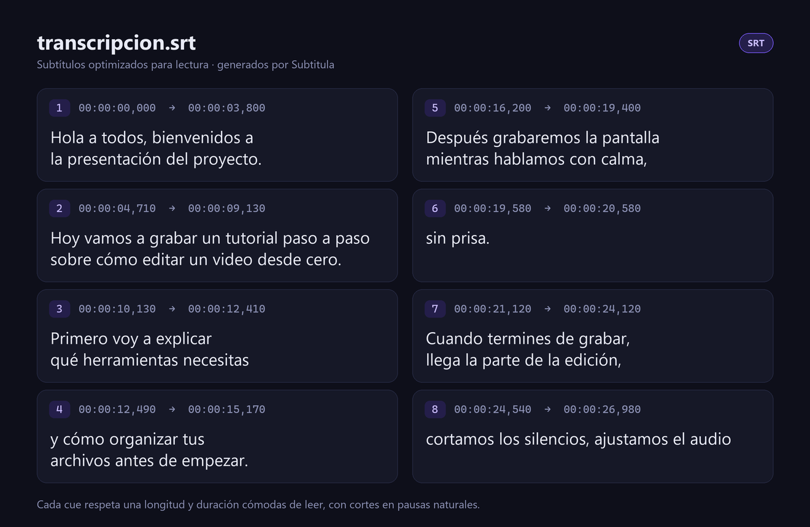

# Subtitula

Aplicación de escritorio para Windows 11 que transcribe y subtitula **tus videos** (y los de YouTube)
**localmente** con [faster-whisper](https://github.com/SYSTRAN/faster-whisper). No usa APIs de pago ni
envía tus archivos a ningún servicio externo.

Flujo principal: **elegir tus videos o pegar un enlace de YouTube → añadir a la cola → iniciar → obtener
la transcripción y los subtítulos**.

## Capturas



*Cola de trabajos terminados con la transcripción del elemento seleccionado, usando la GPU.*



*Transcripción en curso: progreso real y texto en vivo mientras se procesa.*



*Al pegar un enlace de YouTube se muestra la vista previa antes de añadirlo.*



*Subtítulos cómodos de leer: máximo 2 líneas por cue, con cortes en pausas naturales.*

## Qué hace

- Descarga solo el audio de un video y lo transcribe (lo más rápido).
- Descarga el video completo (eligiendo la calidad) y lo transcribe.
- Solo descarga, sin transcribir.
- Transcribe archivos locales: MP4, MKV, MOV, AVI, WEBM, MP3, WAV, M4A, FLAC (también OGG y OPUS).
  Puedes seleccionar archivos, una carpeta completa o arrastrarlos a la ventana.
- Detecta listas de reproducción y añade cada video como un trabajo independiente.
- Procesa la cola en orden, sin bloquear la interfaz; si un trabajo falla, sigue con el siguiente.
- Muestra el texto mientras se transcribe y permite copiarlo o abrirlo desde la propia aplicación.
- Exporta TXT, SRT, VTT, Markdown y JSON.
- Genera subtítulos cómodos de leer (máximo 2 líneas de 42 caracteres, entre 1 y 7 segundos, cortes en pausas
  naturales). Se pueden desactivar con "Subtítulos optimizados para lectura".
- Usa la GPU NVIDIA cuando funciona de verdad; si no, avisa y continúa con la CPU.

## Instalar (sin Python)

Para usar la aplicación sin instalar Python ni uv:

1. Descarga `Subtitula-Setup-<versión>.exe` desde la sección **Releases** del repositorio en GitHub.
2. Ejecútalo y sigue el asistente (pide permisos de administrador para instalar en `Archivos de programa`).
3. Abre **Subtitula** desde el menú Inicio.

Notas:

- El instalador **no está firmado**, así que Windows SmartScreen mostrará un aviso. Pulsa
  **Más información → Ejecutar de todas formas**.
- **FFmpeg es recomendable** y no viene incluido: `winget install Gyan.FFmpeg`.
- El controlador NVIDIA solo hace falta para usar la GPU; sin él funciona con la CPU.
- Los modelos se descargan la primera vez que se usan en `%LOCALAPPDATA%\Subtitula\models`.
  Las preferencias y los registros están en esa misma carpeta, y los resultados se guardan por defecto en
  `Videos\Subtitula`.
- Si venías de la versión 0.1.0 (YouTube Whisper Studio), el instalador la reemplaza y la aplicación mueve
  tus modelos y preferencias a la nueva carpeta; tus resultados anteriores no se tocan.
- Al desinstalar se pregunta si también quieres borrar la configuración y los modelos descargados.

## Requisitos (desde el código)

| Componente | ¿Hace falta instalarlo aparte? |
|------------|--------------------------------|
| [uv](https://docs.astral.sh/uv/) | Sí: `winget install astral-sh.uv` |
| Python 3.12 | No, uv lo descarga solo |
| Dependencias de Python, cuBLAS y cuDNN de NVIDIA, Deno (para YouTube) | No, las instala `uv sync` |
| FFmpeg | **Recomendado**: `winget install Gyan.FFmpeg` |
| Controlador NVIDIA | Solo para usar la GPU (ver abajo) |

### FFmpeg

Sin FFmpeg la aplicación funciona, pero con limitaciones:

- Los videos en modo "Video + transcripción" se descargan en un único archivo de calidad limitada,
  porque no se pueden unir pistas separadas de video y audio.
- No se puede conocer la duración de los archivos de antemano, así que la barra de progreso de la
  transcripción se muestra como indeterminada.

Después de instalarlo, cierra y vuelve a abrir la terminal para que se detecte.

### GPU NVIDIA

Solo necesitas un **controlador NVIDIA actualizado** compatible con CUDA 12 (descárgalo desde
[nvidia.com/drivers](https://www.nvidia.com/Download/index.aspx)). **No** hace falta instalar el
CUDA Toolkit ni cuDNN: las bibliotecas necesarias (`cublas64_12.dll`, `cudnn64_9.dll`) vienen en
paquetes de Python que instala `uv sync`, y la aplicación las registra solo para su propio proceso.
No modifica el PATH del sistema ni la configuración de Windows.

Al cargar el modelo, la aplicación ejecuta una inferencia real en la GPU para comprobar que CUDA
funciona. Detectar una tarjeta no basta: si la prueba falla (bibliotecas, memoria, controlador),
verás un aviso con el motivo y el trabajo continuará en CPU con el **mismo modelo** y precisión
`int8`. Si eliges "GPU (CUDA)" en vez de "Automático", la aplicación no recurre a la CPU y muestra
el error.

## Instalación y uso (desde el código)

```powershell
uv sync
uv run python main.py
```

O haz doble clic en `start.bat`, que instala lo necesario y abre la aplicación.

La primera vez que uses un modelo se descarga automáticamente (de `tiny`, unos 75 MB, a
`large-v3`, unos 3 GB) en `data/models`.

## Elegir modelo

| Modelo | Calidad | Uso recomendado |
|--------|---------|-----------------|
| tiny / base | Baja | Pruebas rápidas |
| small | Buena | CPU (valor predeterminado sin GPU) |
| medium | Muy buena | GPU (valor predeterminado con CUDA) |
| large-v3 | La mejor | GPU con 6 GB de VRAM o más |

Con una GPU de 4 GB, `medium` en `int8_float16` funciona bien. Si aparece un error de memoria
insuficiente, elige un modelo más pequeño o cambia a CPU.

## Dónde quedan los resultados

Cada video o archivo tiene su propia carpeta dentro de la carpeta de salida (por defecto `outputs/`):

```text
outputs/
  Mi video-[dQw4w9WgXcQ]/
    transcripcion.txt
    transcripcion.srt
    transcripcion.vtt
    transcripcion.md
    metadata.json
```

Los videos de una lista de reproducción se agrupan en una sola carpeta con el nombre de la lista,
numerados en el orden de la lista:

```text
outputs/
  Mi curso-[PLxxxxxxxx]/
    01 - Introducción-[abc123]/
    02 - Instalación-[def456]/
```

Al añadir una carpeta de archivos locales, los resultados se agrupan bajo una carpeta con su mismo
nombre y se respetan sus subcarpetas. Los archivos añadidos sueltos tienen su propia carpeta:

```text
outputs/
  git/
    M0S1-introduccion-[a1b2c3d4]/
    modulo2/
      M2S1-ramas-[e5f6a7b8]/
```

- El audio descargado para transcribir se borra al terminar, salvo que actives
  "Conservar archivos multimedia". En "Video + transcripción" y "Solo descargar" el archivo
  descargado siempre se conserva.
- Los archivos locales nunca se modifican ni se mueven.
- Si ya existe una transcripción completa, se omite o se regenera según la opción
  "Si ya existe una transcripción".
- Si cancelas un trabajo, se borran solo sus archivos parciales; las transcripciones anteriores
  quedan intactas.
- Si algún trabajo falla, "Reintentar fallidos" lo vuelve a poner en la cola, y "Abrir registro"
  muestra el detalle de cada error.
- Los nombres de carpeta se acortan cuando hace falta para no superar el límite de rutas de Windows.

## Configuración y registros

- Preferencias: `data/settings.json` (se guardan automáticamente al cambiar cualquier opción).
- Registro técnico de errores: `data/logs/app.log`.
- El botón **Diagnóstico** comprueba Python, FFmpeg, FFprobe, faster-whisper, CUDA, cuBLAS,
  cuDNN, permisos de escritura y la carpeta de modelos, y explica cómo resolver cada problema.

## Limitaciones

- Solo descarga contenido accesible públicamente. No elude DRM, inicios de sesión ni
  restricciones de edad o región.
- El progreso de la transcripción se calcula con la duración real del archivo; con el filtro de
  voz (VAD) activado avanza a saltos, porque los silencios se omiten.

## Desarrollo

```powershell
uv run pytest
```

El código está en `whisper_studio/`: descargas (`downloader.py`), motor de transcripción
(`transcriber.py`), exportación (`exporters.py`), cola de trabajos (`job_queue.py`),
configuración (`config.py`), diagnóstico (`diagnostics.py`) e interfaz (`ui/`).

### Crear el instalador

Requiere [NSIS 3](https://nsis.sourceforge.io/) (`winget install NSIS.NSIS`) y las dependencias de desarrollo
(`uv sync`). Desde la raíz del repositorio:

```powershell
powershell -ExecutionPolicy Bypass -File packaging/build.ps1
```

Ejecuta las pruebas, empaqueta con PyInstaller (`packaging/whisper_studio.spec`) y genera
`dist/Subtitula-Setup-<versión>.exe` con `packaging/installer.nsi`. La versión sale de
`whisper_studio.__version__` y debe coincidir con `pyproject.toml`. El icono se regenera con
`uv run python packaging/make_icon.py`. Con `-SkipTests` se omiten las pruebas.

### Autodiagnóstico

`Subtitula.exe --self-test <audio.wav> <informe.json>` (o `python main.py --self-test ...`)
no abre la ventana: carga el modelo `tiny`, transcribe el audio indicado, consulta un video de YouTube
y escribe un informe JSON con el dispositivo usado y los errores. Termina con código 0 si todo funciona
y 1 si algo falla. Sirve para comprobar una instalación.
